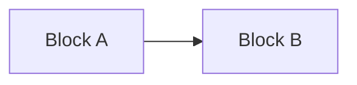

# 02 Architecture: 20261121-1 Fuente de laboratorio

<!-- Extended only. Core projects use the Architecture section of README.md and do not keep this file. -->

Gate: G1 | Version: draft

## Block diagram

<!-- Mermaid or an image committed under docs/. Boxes = blocks, arrows = interfaces. -->

## Blocks

| Block | Function | REQ allocated | Critical (simulate) | Related DEC |
|---|---|---|---|---|
| TBD | | | yes / no | |

## Interfaces

| ID | From | To | Signal / bus | Direction | Range / levels | Connector / pins |
|---|---|---|---|---|---|---|
| IF-01 | | | | | | |

## Bring-up order

<!-- The order in which blocks are energized and verified in docs/05 (BU steps). Upstream blocks first. -->

| Order | Block | Precondition |
|---|---|---|
| 1 | | |

## Open risks

| Risk | Affects | Mitigation / how it will be verified |
|---|---|---|
